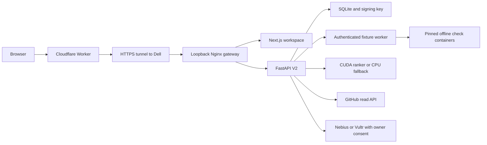

# AegisPR architecture and operating scope

AegisPR reviews an exact change and records the evidence behind its verdict. The V1 workflow introduced change analysis, base/head checks, a verification timeline, and explicit repair verification. V2 uses the same evidence principles and adds a repeatable fixture catalog, SHA-pinned source reviews, signed receipts, SARIF, and a model budget ledger. [Prior-work disclosure](../PRIOR_WORK.md).

## Online request path

Public requests can list or execute committed fixtures. The worker accepts fixture IDs and executes fixed Python or JavaScript checks, with networking disabled. The API verifies the worker's signed output and seals the final evidence record. The gateway leaves the original V1 execution API on its private deployment. Operators interested in V1 should follow the trusted-install workflow in the [original project documentation](PROJECT_DOCUMENTATION.md).

Owner access is required for pinned source reviews, review history, model settings and benchmark runs. SHA verification and the configured diff budget apply before source analysis. Model proposals require explicit consent and can cite evidence without changing the verdict. [Threat model](security.md).

## What the measurements represent

| Measurement | Scope |
| --- | --- |
| Workspace CPU and RAM | Linux host utilization and memory in use, refreshed every five seconds |
| Workspace GPU and VRAM | Ranking device utilization and device memory in use |
| API CPU time and peak RAM in the runtime API | Cumulative CPU time and peak RSS of the API process since startup, returned for compatibility |
| Fixture CPU time | Sum of the check process CPU time, in milliseconds, across recorded repetitions and any repair checks |
| Fixture peak RAM | Largest peak resident set among measured check processes |
| GPU device VRAM | Device-wide used and total memory sampled after context ranking when CUDA provides it |
| Browser JS heap | JavaScript heap usage as a share of its limit when the browser exposes both counters |
| Hosted inference | Recorded requests, input and output tokens, and app-accounted cost. Remotely hosted hardware readings are unavailable |

New fixture and ranking samples are included in signed evidence. Old runs retain their original signatures and show no sample where a counter was absent. The workspace displays live percentages in the left sidebar. A dash indicates an unavailable reading. The open-source Docker stack requires an NVIDIA runtime for the CUDA profile. See the inherited CPU profile and local-model-free V2 fixture verification instructions for development on other systems. [V2 configuration](v2-release.md).

## Release checks

The acceptance sequence is a clean-browser visitor run, receipt verification, fixture repair, owner settings and history access, and a model-free allowlisted PR review. The 12-fixture reference benchmark used 216 executions and reproduced 24 seeded regressions. Its scope and raw results are documented with the [fixture benchmark summary](../evals/results/2026-11-13-dell-fixture-summary.json). The remaining research gates are tracked in the [V2 acceptance matrix](v2-release.md#roadmap-acceptance-status).
