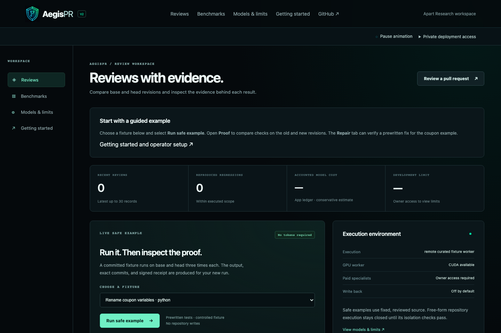
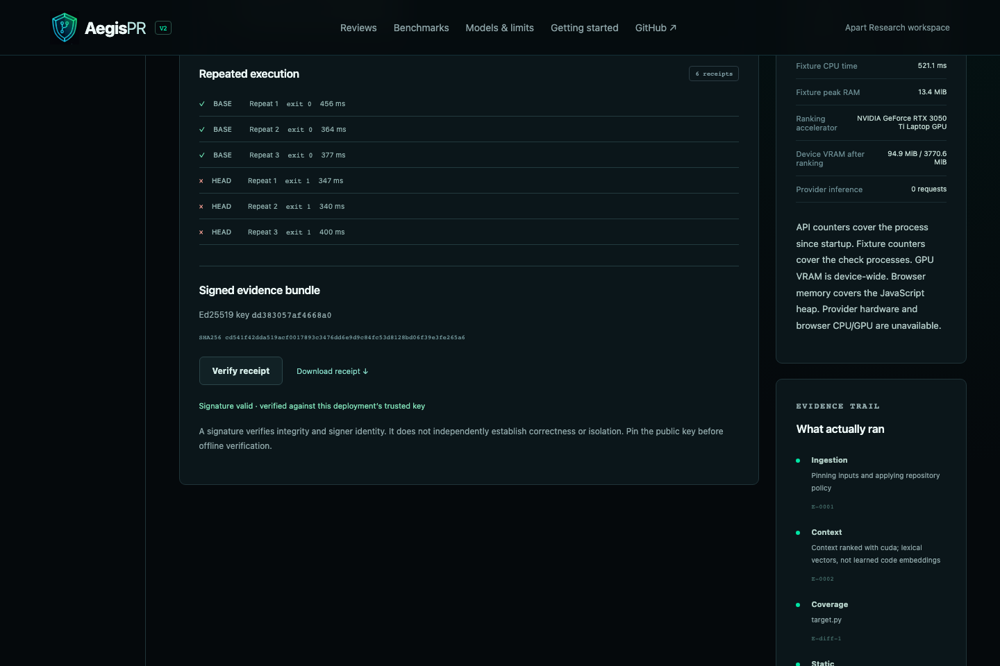
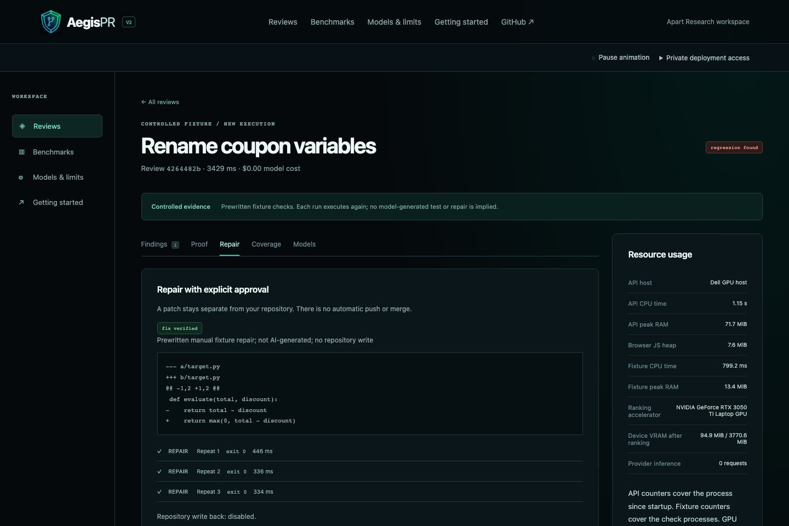

# Online release verification

The checks below ran on November 15, 2026 through the public HTTPS workspace. The browser opened a fresh session. The fixture executed on the Dell host and used zero model calls.

| Check | Observed result |
| --- | --- |
| Coupon fixture | Three base passes and three head failures |
| Explicit fixture repair | Three passes |
| Resource usage | Nine check samples, CUDA ranking with a device VRAM sample, and an API process sample |
| Signed evidence | Verified in the workspace and offline against the key retrieved directly from the Dell deployment |
| Owner boundary | Signed-out history, settings and benchmarks returned HTTP 401. The existing owner code unlocked them |
| Owner PR review | PR #1 completed source analysis across 51 changed files and produced a signed receipt with zero provider calls |
| Mobile onboarding | The 390 px browser rendered the first-visit guide without horizontal overflow |

[Open the recorded coupon fixture](https://aegispr-v2.snap-hub.workers.dev/reviews/4264482b-94b2-42ec-8671-cd3ab19a0b61).

[First-visit guide](images/release/guide.png) and [mobile guide](images/release/mobile-guide.png).
